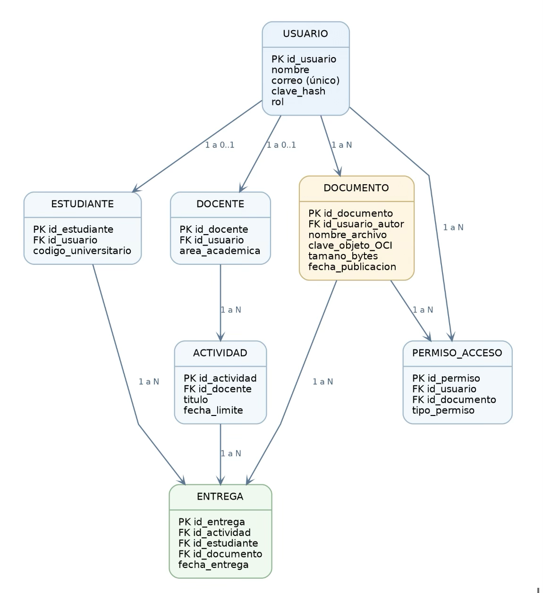

# EduNet: Red TCP/IP para contenido educativo digital

El presente proyecto propone una red TCP/IP para distribuir contenido educativo digital a estudiantes y docentes universitarios de Lima, La Libertad, Junín, Arequipa y Loreto. La propuesta responde a las diferencias de conectividad y latencia existentes entre departamentos, las cuales pueden afectar el acceso desde teléfonos celulares a materiales, actividades y entregas académicas.

## Organizacion

En este repositorio se almacenaran todos los procedimientos (de código) relacionados con el proyecto divididos en capas. La estructura de capas será la siguiente:

- **Capa de Datos**: Base de Datos de MySQL siguiendo el diagrama físico de la BBDD.
- **Capa de Aplicación**: Software Defined Network (SDN) en Python combinando Mininet (para emular switches y hosts) con Ryu (framework controlador SDN que usa el protocolo OpenFlow).

Todas las capas deberán de ser desplegadas en una Virtual Machine de Azure por separado.

## Diagrama Físico de Base de Datos

La Base de datos tiene la siguiente estructura

  

