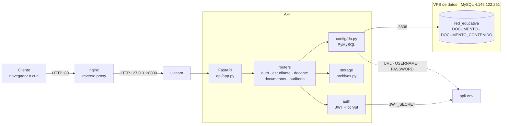
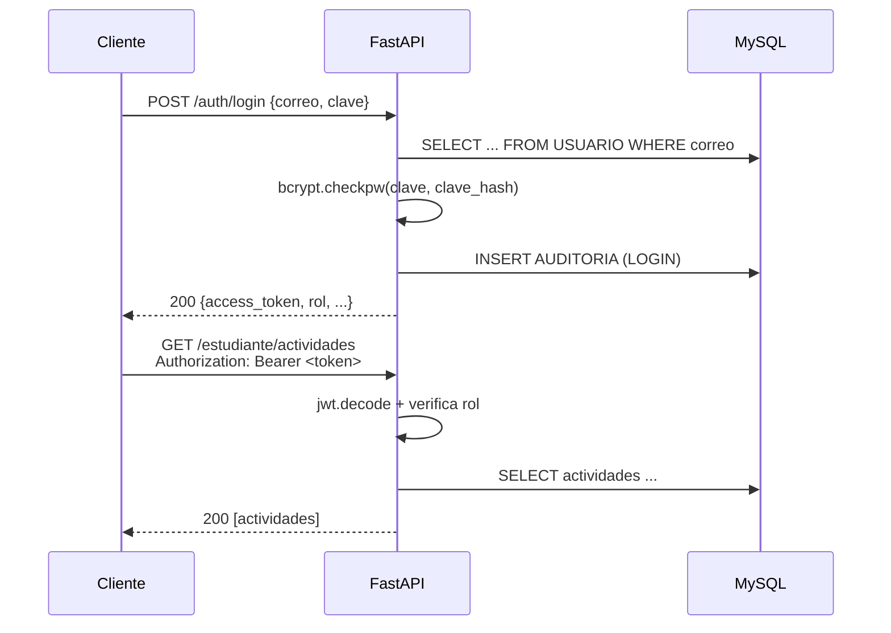
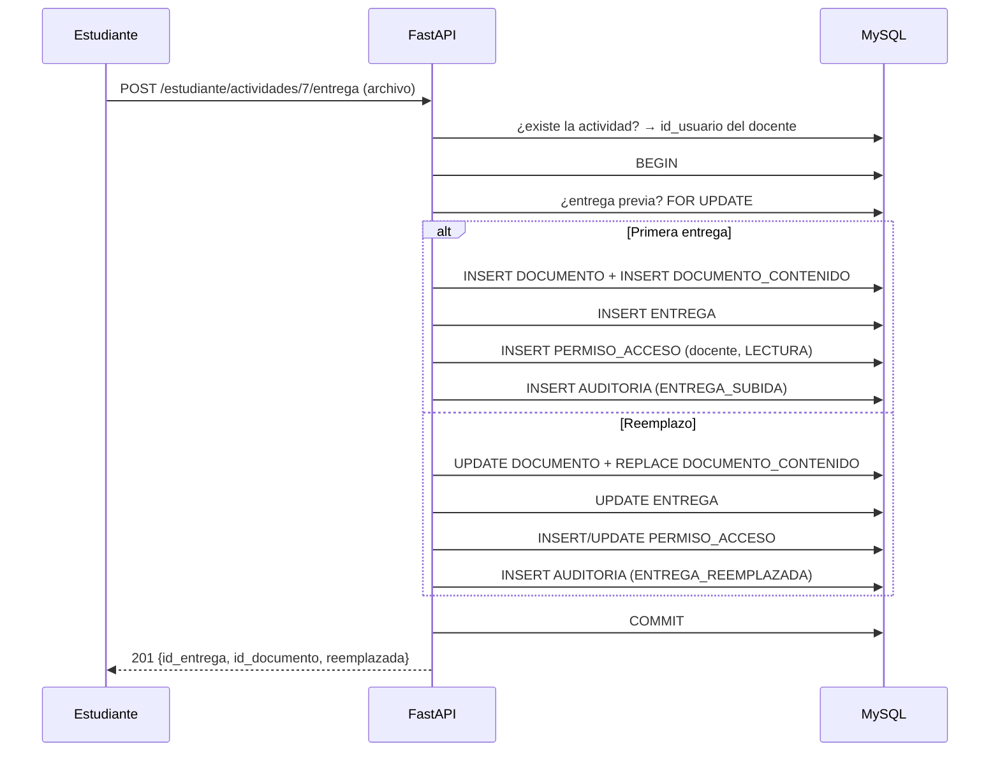

# Diseño de la API EduNet

Documento de diseño de la API en `api/` (FastAPI + MySQL). Para instalación,
migración y despliegue, ver [`api/info.md`](../api/info.md).

## 1. Resumen

La API es un proceso independiente de la capa SDN (Ryu + Mininet). Solo comparte
la base de datos `red_educativa` con ella; no importa código de
`sdn/`.

La base de datos vive en **otra VPS** (`4.149.122.251`). La API se conecta
remotamente mediante la URL:

```
URL=jdbc:mysql://4.149.122.251:3306/red_educativa
```

Responsabilidades:

- **Estudiantes**: ver todas las actividades, subir/reemplazar su entrega y
  descargar material publicado por los docentes.
- **Docentes**: crear actividades, subir material, ver las entregas de sus
  actividades y descargarlas.
- **Auditoría**: toda escritura relevante y cada login/descarga quedan en
  `AUDITORIA`.

## 2. Arquitectura



En la VPS, `api/` se despliega en `/home/azuresdn/api/`, el venv en
`/home/azuresdn/api/.venv/` y el servicio `edunet-api` escucha solo en
`127.0.0.1:8080`.

La VPS de la API y la VPS de datos son máquinas distintas: el tráfico a MySQL
sale por la red hacia `4.149.122.251:3306`. El NSG de la VPS de datos debe
permitir el puerto 3306 solo desde la IP pública de la VPS de la API (nunca
desde Internet).

### Estructura de módulos

| Ruta                      | Responsabilidad                                                                                           |
| ------------------------- | --------------------------------------------------------------------------------------------------------- |
| `api/app.py`              | Crea la app, registra routers y expone `/health`.                                                         |
| `api/config/config.py`    | Lee `.env` (busca `api/.env` y luego hacia arriba) y resuelve la conexión desde `URL` o claves separadas. |
| `api/config/db.py`        | Conexión PyMySQL, helpers `consultar`, `ejecutar`, `transaccion`, `auditar`.                              |
| `api/auth/auth.py`        | Hash bcrypt, JWT HS256 (8 h) y dependencias de rol.                                                       |
| `api/auth/permisos.py`    | Regla de descarga: autor o permiso explícito.                                                             |
| `api/models/schemas.py`   | Modelos Pydantic de entrada y salida.                                                                     |
| `api/routers/`            | Un router por área funcional.                                                                             |
| `api/storage/archivos.py` | Valida el tamaño del archivo subido y devuelve sus bytes (máx. 10 MB).                                   |

## 3. Autenticación y autorización



- Registro abierto en `POST /auth/registro`; crea el `USUARIO` y su perfil
  (`ESTUDIANTE` con `codigo_universitario`, o `DOCENTE` con `area_academica`).
- Las contraseñas se guardan como hash bcrypt (12 rondas) y se rechazan si
  superan 72 bytes UTF-8.
- El token es JWT `HS256` firmado con `JWT_SECRET`, con `sub` (id de usuario),
  `rol` y `exp` a 8 horas. Se envía como `Authorization: Bearer <token>`.
- Dependencias de rol: `usuario_actual`, `solo_estudiante`, `solo_docente`
  (`api/auth/auth.py`). Devuelven 401 sin token válido y 403 con rol incorrecto.
- El rol del token es la única fuente de autorización; no se consulta la BD en
  cada petición para validarlo.

## 4. Endpoints

| Método | Ruta                                   | Rol                 | Descripción                                                 |
| ------ | -------------------------------------- | ------------------- | ----------------------------------------------------------- |
| POST   | `/auth/login`                          | público             | Devuelve JWT y datos del usuario.                           |
| POST   | `/auth/registro`                       | público             | Crea usuario + perfil.                                      |
| GET    | `/health`                              | público             | Comprueba conexión con MySQL (503 si falla).                |
| GET    | `/estudiante/actividades`              | estudiante          | Todas las actividades, con su entrega si existe.            |
| GET    | `/estudiante/entregas`                 | estudiante          | Entregas propias.                                           |
| POST   | `/estudiante/actividades/{id}/entrega` | estudiante          | Sube o reemplaza la entrega (`multipart`, campo `archivo`). |
| GET    | `/docente/actividades`                 | docente             | Actividades propias con número de entregas.                 |
| POST   | `/docente/actividades`                 | docente             | Crea actividad (`titulo`, `fecha_limite` opcional).         |
| GET    | `/docente/actividades/{id}/entregas`   | docente             | Entregas de una actividad propia.                           |
| GET    | `/docente/material`                    | docente             | Documentos publicados por el docente.                       |
| POST   | `/docente/material`                    | docente             | Sube material (`multipart`, campo `archivo`).               |
| GET    | `/documentos/{id}/descarga`            | autor o con permiso | Descarga el archivo y audita.                               |
| GET    | `/auditoria`                           | docente             | Log de acciones (`id_usuario`, `limite` 1–500).             |

Documentación interactiva generada por FastAPI: `/docs` (Swagger) y
`/redoc`. El contrato formal es el OpenAPI en `/openapi.json`.

### Errores habituales

| Código | Cuándo                                                                                   |
| ------ | ---------------------------------------------------------------------------------------- |
| 400    | Archivo vacío o mayor a 10 MB.                                                           |
| 401    | Sin token, token inválido/vencido o credenciales incorrectas.                            |
| 403    | Rol incorrecto, actividad de otro docente, sin permiso de descarga o usuario sin perfil. |
| 404    | Actividad/documento inexistente o documento sin archivo cargado.                          |
| 409    | Correo ya registrado.                                                                    |
| 422    | Datos inválidos (Pydantic) o falta `codigo_universitario`.                               |
| 503    | `/health` sin conexión a MySQL.                                                          |

## 5. Flujo de entrega



El binario se inserta en la misma transacción que los metadatos: si algo falla,
el rollback deshace todo y no quedan archivos huérfanos. La restricción
`UNIQUE (id_actividad, id_estudiante)` garantiza una sola entrega por actividad
y estudiante.

## 6. Reglas de negocio

- **Sin matrícula**: todos los estudiantes ven todas las actividades. Las
  entregas se filtran por `id_estudiante`.
- **Material abierto**: al subir material, se inserta `PERMISO_ACCESO` de
  lectura para todos los usuarios con rol `ESTUDIANTE`.
- **Entrega reemplazable**: una por actividad/estudiante; al reemplazar se
  actualiza el `DOCUMENTO` y se conserva su permiso para el docente.
- **Permisos explícitos**: la descarga se permite si el usuario es el autor del
  documento o tiene fila en `PERMISO_ACCESO` (`api/auth/permisos.py`).
- **Propiedad de actividades**: un docente solo ve entregas de actividades
  suyas, aunque consulte un `id_actividad` ajeno (responde 403).
- **Fechas límite**: informativas; la API no bloquea entregas tardías.

## 7. Almacenamiento de archivos

- El binario vive en `DOCUMENTO_CONTENIDO` (`MEDIUMBLOB`, PK/FK a `DOCUMENTO`
  con `ON DELETE CASCADE`), en la VPS de datos.
- `DOCUMENTO` guarda solo metadatos: nombre original, tamaño y fecha. Los
  listados (`/docente/material`, `/estudiante/entregas`) nunca leen el blob.
- La API valida el tope de 10 MB en `api/storage/archivos.py` antes de insertar.
- MySQL necesita `max_allowed_packet >= 64M`, porque PyMySQL escapa el binario
  y 10 MB pueden viajar como 20-40 MB de paquete.
- Borrar un documento borra su contenido por la FK; ya no hay archivos que
  limpiar ni claves que resolver.
- nginx debe usar `client_max_body_size 10m` o mayor.

## 8. Auditoría

Tabla append-only `AUDITORIA`. Acciones registradas:

| Acción                | Entidad     | Origen                           |
| --------------------- | ----------- | -------------------------------- |
| `LOGIN`               | `USUARIO`   | `POST /auth/login`.              |
| `REGISTRO`            | `USUARIO`   | `POST /auth/registro`.           |
| `ACTIVIDAD_CREADA`    | `ACTIVIDAD` | `POST /docente/actividades`.     |
| `MATERIAL_SUBIDO`     | `DOCUMENTO` | `POST /docente/material`.        |
| `ENTREGA_SUBIDA`      | `ENTREGA`   | Primera entrega.                 |
| `ENTREGA_REEMPLAZADA` | `ENTREGA`   | Reemplazo de entrega.            |
| `DESCARGA`            | `DOCUMENTO` | `GET /documentos/{id}/descarga`. |

Las escrituras se hacen dentro de la misma transacción que la operación
(`db.auditar`). La descarga usa `db.ejecutar` porque no modifica datos de
negocio.
