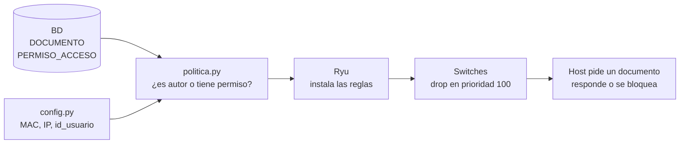

# Capa de aplicación — SDN EduNet (Ryu + Mininet)

Controlador Ryu que programa en los switches OpenFlow la ACL de acceso a documentos
calculada desde `DOCUMENTO` y `PERMISO_ACCESO` de la BD `red_educativa`.

## Cómo funciona

- Cada documento `id_documento = N` se sirve en `http://<ip_del_autor>:8000+N/`.
  El puerto identifica al documento, por eso OpenFlow puede autorizarlo por separado.
- Al conectar un switch, el controlador lee la BD y, por cada host y cada documento
  **sin fila en `PERMISO_ACCESO` y que no sea de su autor**, instala un `drop` de
  prioridad 100. El autor siempre puede leer su documento, igual que en la API.
  El reenvío normal (switch L2 aprendido) queda en prioridad 10.
- Los hosts `invitado-*` no tienen `id_usuario`, así que no tienen permisos.



La BD aporta **qué documentos hay y quién tiene permiso**; `config.py` aporta
**quién es cada host** (MAC/IP/`id_usuario`); `politica.py` junta ambos y decide.

| Switch | Sede        | Hosts                        |
| ------ | ----------- | ---------------------------- |
| s1     | Lima        | doc_carlos (1), est_luis (3) |
| s2     | La Libertad | doc_ana (2), est_maria (4)   |
| s3     | Junín       | est_pedro (5), invitado_1    |
| s4     | Arequipa    | est_lucia (6), invitado_2    |
| s5     | Loreto      | invitado_3, invitado_4       |

El detalle de IP/MAC/`id_usuario` está en `edunet/config.py`.

## Estructura

```
sdn/
├── sdn_controlador.py      # app Ryu (se ejecuta con ryu-manager)
├── topologia.py            # topología Mininet
├── servidor_documentos.py  # servidor HTTP de documentos de un autor
├── requirements.txt
├── config/                 # lógica reutilizable
│   ├── config.py           # sedes, hosts, IP/MAC/id_usuario
│   ├── db.py               # conexión y consultas a MySQL
│   └── politica.py         # ACL calculada desde PERMISO_ACCESO
└── tests/
    └── test_politica.py
```

Los tres scripts se ejecutan desde `sdn/`, así se importa el paquete
`edunet` sin tocar `sys.path`.

## Instalación (VM Ubuntu con Mininet)

> [!NOTE]
> Dentro de la VM, el directorio se llama `/capa_aplicacion`

```bash
sudo apt install -y mininet python3-pip
pip3 install -r requirements.txt
```

`.env` debe apuntar a la BD de la capa de datos. El código lo busca desde
`capa_aplicacion/config/` hacia arriba, así que funciona tanto en la raíz del
proyecto como dentro de `capa_aplicacion/`:

```
URL=jdbc:mysql://4.149.122.251:3306/red_educativa
USERNAME=appuser
PASSWORD=...
```

También se aceptan las claves por separado (`SERVER_HOST`, `PORT`, `DATABASE`)
y variables de entorno con esos mismos nombres. Si falta alguna, el error indica
qué claves faltan y qué `.env` se usó.

La BD tiene que estar levantada antes de arrancar el controlador: si no responde,
el controlador no arranca (no se deja la red sin política).

### Si la capa de datos está en otra VM

El código no cambia: solo el `URL` del `.env` apunta a la IP de la VM de datos.
En la VM de datos hay que permitir el acceso remoto:

```bash
# /etc/mysql/mysql.conf.d/mysqld.cnf
bind-address = 0.0.0.0
sudo systemctl restart mysql
```

Y abrir el puerto 3306 **solo para la IP de la VM de aplicación** (regla de entrada
del NSG de Azure y, si está activo, `ufw`). El usuario `appuser@'%'` ya está en
`capa_datos/creacion_permisos.sql`.

La topología usa un solo dominio L2 (`10.0.0.0/8`); el tercer octeto identifica
la sede. Con `/24` por sede haría falta un router entre sedes, que no existe.
El NAT (`red.addNAT()`) da salida hacia la BD; el tráfico sigue saliendo con la IP
de la VM de aplicación, la misma que ya usa Ryu, así que no hay que cambiar nada
más en la VM de datos.

Verificación desde un host: `doc_carlos ip route` debe mostrar
`default via 10.0.0.11 dev doc_carlos-eth0 ... onlink`.

## Arranque

```bash
# Terminal 1
ryu-manager sdn_controlador.py

# Terminal 2
sudo python3 topologia.py
```

Dentro de la CLI de Mininet, levantar el servidor de documentos de un autor.
Los hosts de Mininet usan el `python3` del sistema, **no** el de la `.venv`,
así que hay que llamar al intérprete de la venv (ajusta la ruta si difiere):

```
doc_carlos /home/azuresdn/capa_aplicacion/.venv/bin/python servidor_documentos.py 1 &
doc_ana /home/azuresdn/capa_aplicacion/.venv/bin/python servidor_documentos.py 2 &
est_luis /home/azuresdn/capa_aplicacion/.venv/bin/python servidor_documentos.py 3 &
est_maria /home/azuresdn/capa_aplicacion/.venv/bin/python servidor_documentos.py 4 &
```

## Pruebas funcionales

```
est_luis curl -s --max-time 3 http://10.0.1.11:8301/   # 200 (permiso 502)
est_luis curl -s --max-time 3 http://10.0.2.11:8302/   # sin salida: bloqueado
est_maria curl -s --max-time 3 http://10.0.1.11:8301/  # 200 (permiso 503)
est_pedro curl -s --max-time 3 http://10.0.2.11:8302/  # 200 (permiso 505)
est_lucia curl -s --max-time 3 http://10.0.1.11:8301/  # sin salida: bloqueado
doc_carlos curl -s --max-time 3 http://10.0.1.12:8303/ # 200 (permiso 507)
invitado_1 curl -s --max-time 3 http://10.0.1.11:8301/ # sin salida: bloqueado
```

Evidencia de las reglas instaladas:

```bash
sudo ovs-ofctl -O OpenFlow13 dump-flows s1 | grep "tcp_dst=8302"
```

## Prueba unitaria

```bash
cd capa_aplicacion
python3 -m unittest discover -s tests -v
```

## Límites conocidos

- La política se instala al conectar cada switch: si cambian los permisos en la BD
  hay que reiniciar el controlador. `shortcut: reaplicar reglas en caliente, cuando la BD cambie durante la demo`
- El usuario se identifica por la MAC fija del host: quien falsifique esa MAC evita la ACL.
- Solo se filtra TCP a los puertos de documentos; el resto del tráfico es reenvío L2 normal.
